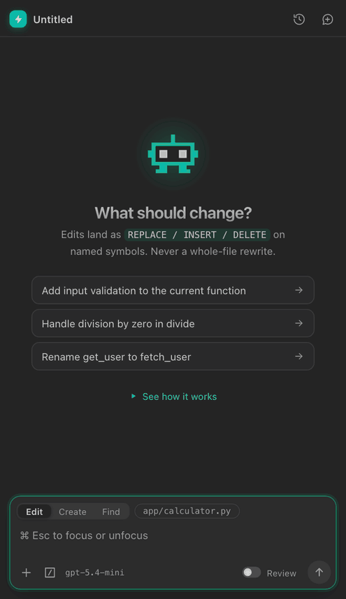

<p align="center"></p>

# Incremental Editing Engine for VS Code

Chat with the [Incremental Editing Engine](https://github.com/Atharv96KOG1/incremental-editing-engine) from the VS Code sidebar. Describe a change. The engine finds the one function or block it touches and sends only that to the model. You review the diff before anything is written.



The extension doesn't reimplement the engine. It starts the engine's local backend (`iee serve`) and talks to it from a native sidebar chat.

## Requirements

The engine itself must be installed and importable by Python — this extension just launches it.

```bash
git clone https://github.com/Atharv96KOG1/incremental-editing-engine.git
cd incremental-editing-engine
pip install -e .
```

This installs the `iee` console script the extension looks for on `PATH`. If you'd rather not put it on `PATH`, point the extension at it directly (see Settings below).

You'll also need an `OPENAI_API_KEY` in the engine repo's `.env` (the engine calls OpenAI for generation and repair). Storage defaults to local disk; MinIO is optional (see the repo's `docker-compose.yml`). The repo's `README.md` has full setup.

## Usage

- Click the **⚡ Incremental Editing** icon in the Activity Bar, press **Cmd+Esc** (Ctrl+Esc on Windows/Linux), or click **IEE** in the status bar. Tip: drag the view into the Secondary Side Bar to keep it beside your editor.
- Pick a mode with the switch above the input: **Edit** (change existing code), **Create** (write a new file) or **Find** (locate code, no edits).
- In Edit mode the file in the active editor is the target. Click its chip to let the engine auto-locate the file instead, or press **+** to pick another file.
- Type **/** for commands: `/edit`, `/create`, `/find`, `/file`, `/auto`, `/new`, `/history`, `/settings`.
- **Review** (default): each validated diff waits for **Accept** or **Reject**. Nothing touches disk before you accept. Turn on **Auto-apply** to write validated changes straight away.
- **Open diff** opens the proposed file in VS Code's diff editor.
- Conversations are saved per workspace. Use the clock icon to resume one, and the bubble icon to start a new one.
- **Incremental Editing Engine: See How It Works** opens a short walkthrough with the demo above.
- **Open Full Web UI** opens the engine's full web app (file explorer, tabs) in an editor tab. **Start / Stop / Restart Server** control the backend.

## Settings

| Setting | Default | Description |
|---|---|---|
| `incrementalEditingEngine.command` | `iee` | Command (or full path) used to launch the backend. |
| `incrementalEditingEngine.pythonFallback` | `python3` | Used to run `-m incremental_editing.cli serve` if `command` isn't found. |
| `incrementalEditingEngine.host` | `127.0.0.1` | Host the backend binds to. |
| `incrementalEditingEngine.port` | `8787` | Port the backend binds to. |
| `incrementalEditingEngine.projectDir` | *(empty)* | Project directory to preset in the chat UI. Empty uses the first open workspace folder. |

## Building from source

```bash
cd vscode-extension
npm install
npm run compile      # builds dist/extension.js
npm run package      # produces a .vsix via @vscode/vsce
```

Install the resulting `.vsix` via the Extensions view → `...` menu → **Install from VSIX...**, or:

```bash
code --install-extension incremental-editing-engine-0.1.0.vsix
```
